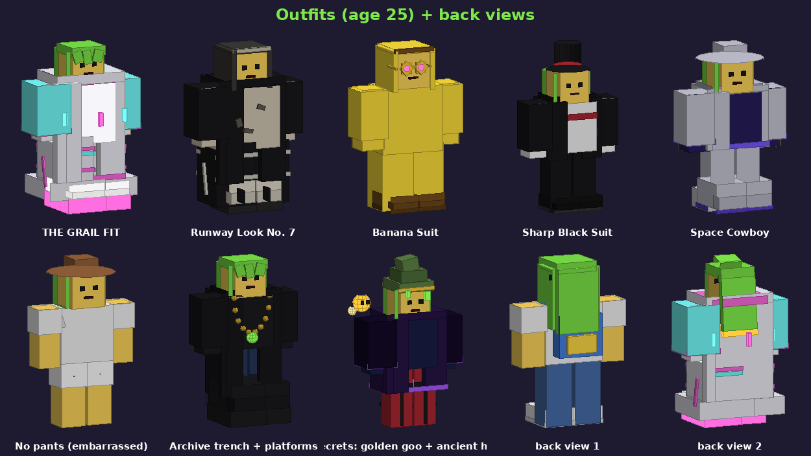

# Raise Brady Goo

A funny Roblox meme / tycoon-style game. You get a small house and a goofy baby
called **Brady Goo**. Feed him, clean him, play with him and put him to bed to
earn **Goo Coins** and **Age XP**. As he ages from *Baby Brady* (1) to
*Legendary Brady Goo* (25) he changes body shape, hair, face, walk and idle
animations, unlocks clothing categories, moves into a bigger house and gifts
you wearable pieces for your own avatar. The long-term chase is fashion:
Common → Uncommon → Rare → Epic → Legendary → **Archive** → **Grail**.


> The preview images in `docs/` are drawn by a small offline renderer from the
> exact geometry the game builds (`tools/`). They are **not** Roblox
> screenshots: no lighting, materials, particles or text. They show shapes,
> proportions, colours and layout.

---

## Play it in 5 minutes

1. Download **`RaiseBradyGoo.rbxlx`** from this repository and open it in
   Roblox Studio.
2. **File → Publish to Roblox** (saving needs a published place).
3. **Game Settings → Security → Enable Studio Access to API Services** so
   progress saves while testing in Studio. Without it the game still runs, on
   temporary data, and prints a warning.
4. **Game Settings → Places → Max Players**: 12 or fewer is recommended (there
   are 12 house plots; more players get extra plots further down the street).
5. Press **Play**.

The Workspace looks almost empty in Edit mode. That is expected: the map,
houses and Bradys are built by the server the moment the game starts.

Developers who prefer a sync workflow can use [Rojo](https://rojo.space):
`rojo serve` and connect the Studio plugin, or
`rojo build default.project.json -o RaiseBradyGoo.rbxlx`.

---

## Read this first: what was and was not tested

This project was written without access to Roblox Studio. I could not press
Play. What I did instead:

* **`tests/`** contains a fake Roblox engine that runs under
  [Lune](https://lune-org.github.io/docs). It uses the *real* Roblox class and
  property database, so a wrong property name or type fails just like in
  Studio, and runs the game's actual scripts on a virtual clock.
* **66 automated scenarios pass**: every shared module, every clothing /
  furniture / gift / house recipe, a full server boot, joining, all care
  actions, all six mini-games, shop, crates (hundreds of rolls), ageing 1 → 25,
  rebirth, every random event, a complete fashion show with voting, daily
  rewards across a simulated week, hidden items, multiplayer visiting, saving /
  rejoining, session locks, DataStore outages, corrupt saves, exploit-style bad
  remote arguments, a two hour soak, and all 17 client scripts driven through
  their real buttons including ~400 random button presses.

That gives good confidence in the **logic**. It gives **no** confidence in
anything that needs a real client. Expect to tune these in Studio:

| Not verified | Why it matters |
| --- | --- |
| How it actually looks (lighting, materials, emoji icons, text fit) | The renderer in `tools/` only checks shapes |
| Animation feel | All animation is maths in `BradyAnimator`; angles were reasoned, not watched |
| UI on a real phone | Layout scales by formula; touch ergonomics are untested |
| Camera in mirror mode, prompt distances, map scale, obby difficulty | Need hands-on play |
| Physics | The fake engine has none: collisions, jumping and the obby route are unplayed |
| The built-in sound file names | They are standard Roblox client sounds, but a missing one just plays nothing |
| Real DataStore behaviour and network latency | Tested against a fake DataStore only |
| Game balance | Numbers are a reasoned first pass (see `Config.luau`) |

If something errors on first Play, the Output window will name the script and
line. The most likely first-run issues are visual, not logical.

---

## What is in the game

| System | Where | Notes |
| --- | --- | --- |
| 10 life stages, ages 1–25, XP curve | `Modules/AgeSystem` | each stage: proportions, hair, face, idle, walk, unlocks |
| 116 clothing items in 9 categories, 7 rarities | `Modules/ClothingSystem` | data-driven: add a row, no modelling |
| Brady model + every clothing piece built from parts | `Modules/Builders/BradyBuilder` | no meshes or image assets |
| Procedural animation: 7 idles, 8 walks, 14 poses, 13 actions | `Client/BradyAnimator` | no uploaded animation assets |
| Care: feed, shower, brush, shoes, sleep, toys, follow | `Services/CareServer` | four meters, mood changes XP |
| Mini-games: catch, target, reaction, soccer, dance, obby | `StarterGui/MinigameUI`, `Services/MinigameServer` | |
| Goo Coins, shop, 4 crates with visible odds | `Services/ShopServer`, `Modules/ShopSystem` | coins cannot be bought |
| House that grows every stage, 10 stations, grid furniture | `World/HouseBuilder`, `Services/HouseServer`, `StarterGui/RoomUI` | 37 furniture pieces |
| Mirror mode: poses, close camera, screenshot | `StarterGui/MirrorUI` | |
| 7 random events | `Services/EventServer` | |
| Fashion show: sign-up, runway, voting, titles, bots | `Services/FashionServer` | works with one player |
| Collection book, 29 achievements, daily reward + tasks | `Services/CollectionServer`, `DailyServer`, `AchievementServer` | |
| 24 hidden goo blobs, 6 secret items, secret cave | `Services/CollectionServer`, `World/MapBuilder` | |
| Gifts for the player's own avatar | `Modules/GiftSystem`, `Services/GiftServer` | |
| Rebirth | `Services/AgeServer` | permanent +25% per rebirth |
| Multiplayer: visit, inspect, hype | `Services/SocialServer` | read-only: no trading, no stealing |
| Saving with session locks | `Services/DataServer`, `Modules/DataManager` | |
| Tutorial | `StarterGui/TutorialUI` | |



---

## Project layout

```
default.project.json           Rojo project
RaiseBradyGoo.rbxlx            ready-to-open place file (built from src/)
src/
  ReplicatedStorage/
    Modules/                   shared data + rules (AgeSystem, ClothingSystem,
      Builders/                InventorySystem, CurrencySystem, DataManager,
                               EventSystem, FashionSystem, CollectionSystem ...)
    Client/                    ClientState, UI kit, BradyAnimator, Preview
  ServerScriptService/
    Main.server.luau           the only Script: boots everything in order
    Services/                  DataServer, AgeServer, CurrencyServer,
                               ClothingServer, EventServer, FashionServer ...
    World/                     MapBuilder, HouseBuilder
  StarterGui/                  MainUI, AgeUI, InventoryUI, WardrobeUI, ShopUI,
                               CollectionUI, RoomUI, FashionUI, BradyUI ...
  StarterPlayer/StarterPlayerScripts/   BradyClient, WorldClient
tests/                         fake engine + test suite (developer tool)
tools/                         preview renderer (developer tool)
```

### Where this differs from the structure you suggested, and why

* **Server systems are ModuleScripts loaded by one `Main` Script**, not
  separate Scripts. Separate Scripts all start at once with no guaranteed
  order, which causes "X is not ready yet" bugs. One entry point decides the
  order. The names you asked for (`DataServer`, `AgeServer`, `CurrencyServer`,
  `ClothingServer`, `EventServer`, `FashionServer`) are all there.
* **`DataManager` in ReplicatedStorage is only the save-data schema.** The code
  that talks to DataStores is `Services/DataServer`, which clients cannot
  reach. DataStore code in ReplicatedStorage would be readable by exploiters.
* **The map and houses are built by code at server start** instead of being
  hand-placed. That keeps the project plain text and keeps gameplay positions
  in sync with scenery. The trade-off: you cannot drag things around in Edit
  mode. `World/MapBuilder.luau` explains how to switch to a hand-edited map.

---

## Security model

The client is never trusted with anything that matters.

* Coins, XP, items, furniture, daily rewards and titles only change on the
  server. The client's copy (`ClientState`) is display-only.
* Every remote validates its arguments and is rate limited (`Services/Net`).
* One-time rewards write their "claimed" flag **before** paying out.
* Mini-game scores are the one thing the client reports. The server issues a
  one-use token, charges energy up front, clamps the score, rejects rounds
  that finish impossibly fast and applies a cooldown. A cheater can at best
  earn the same as a perfect player, limited by energy.
* Saves use `UpdateAsync` with a session lock, are repaired by
  `DataManager.reconcile` on load, and a failed load kicks the player instead
  of handing out a blank profile that would overwrite the real one.

---

## Things you need to fill in

| What | Where | Default |
| --- | --- | --- |
| Gamepass IDs | `Modules/Monetization.luau` | all `0` = nothing for sale |
| Background music | `Modules/Sounds.luau` → `Sounds.Music` | none |
| Your own sound effects | `Modules/Sounds.luau` | built-in Roblox client sounds |
| Balance | `Modules/Config.luau`, `AgeSystem.xpToNext` | first pass |

Monetization is optional and cosmetic / convenience only. There is no way to
buy Goo Coins, XP or clothing with Robux, so crates are never a paid random
item. Their odds are shown in the shop anyway.

---

## Known limitations

* The mirror is a camera close-up, not a real reflection (Roblox has no
  real-time mirrors).
* Brady walks in straight lines without pathfinding and can clip through
  furniture.
* Faces and shirt graphics are SurfaceGuis, which ViewportFrames cannot draw,
  so the wardrobe preview uses a simplified face.
* The session lock is a compact implementation. For a large live game,
  consider a battle-tested library such as ProfileStore.
* Screenshots use `CaptureService`, which is not available on every platform;
  the game falls back to a message.
* Rebirth shrinks the house again, so some furniture returns to storage.

---

## Running the tests

```
cargo install rojo lune          # once
rojo build default.project.json -o build/test.rbxl
lune run tests/run.luau          # about 4 minutes
```

Preview images:

```
lune run tools/export_scenes.luau && python3 tools/render_scenes.py
```
